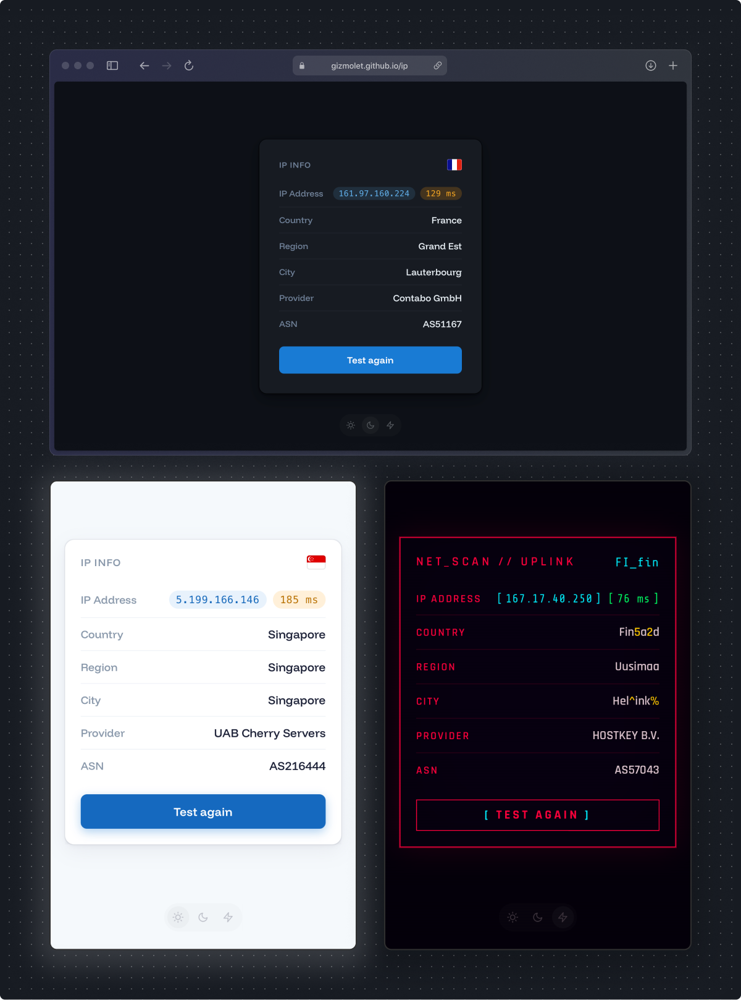

# IP Info

A minimal single-page app that shows your IP address and network details.

Instant IP lookup — no ads, no tracking, no noise.

## Live

https://gizmolet.github.io/ip/

## Features

- IPv4 address (click to copy)
- Country (with flag), region, city, provider, ASN
- Ping: network latency to 1.1.1.1
- Map of your country with a dot on your city (desktop only), drawn locally as SVG: no map libraries, no tiles, no third-party map requests
- Light / Dark / Cyberpunk themes
- Responsive, no dependencies, no build step

